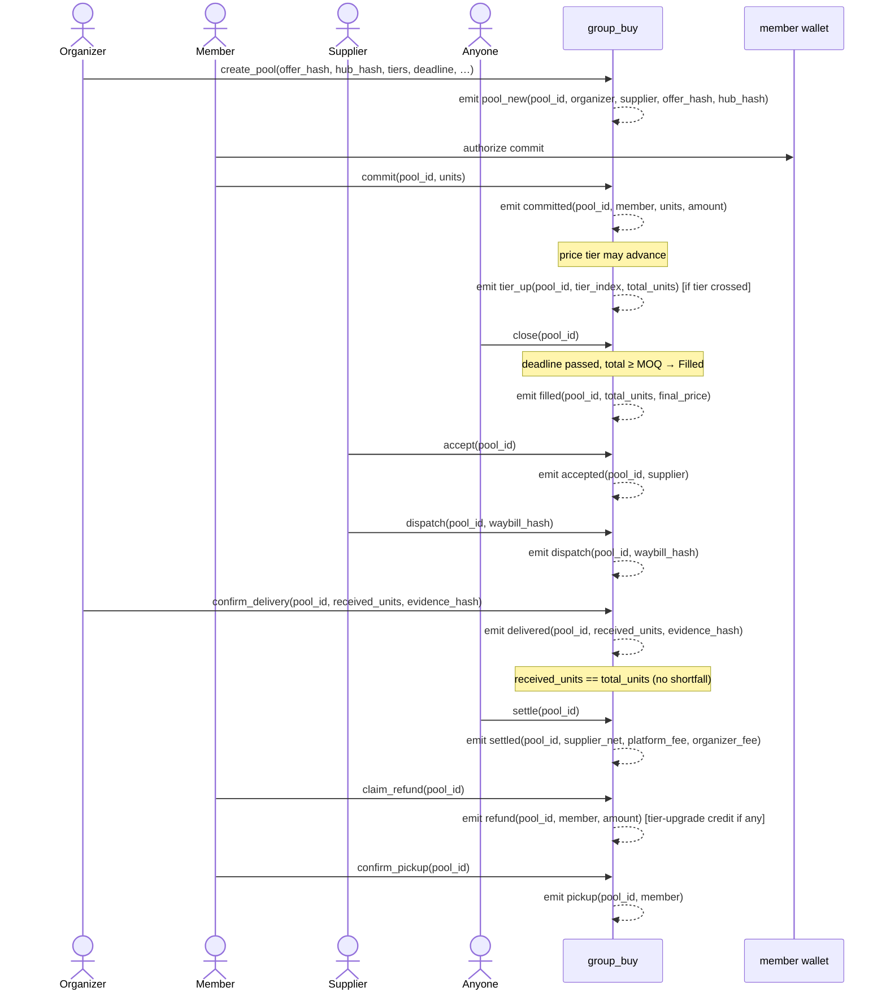
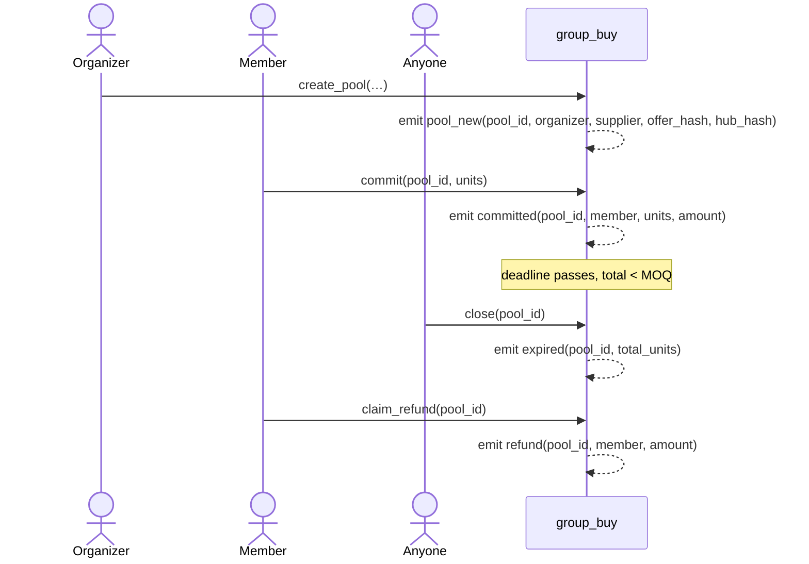
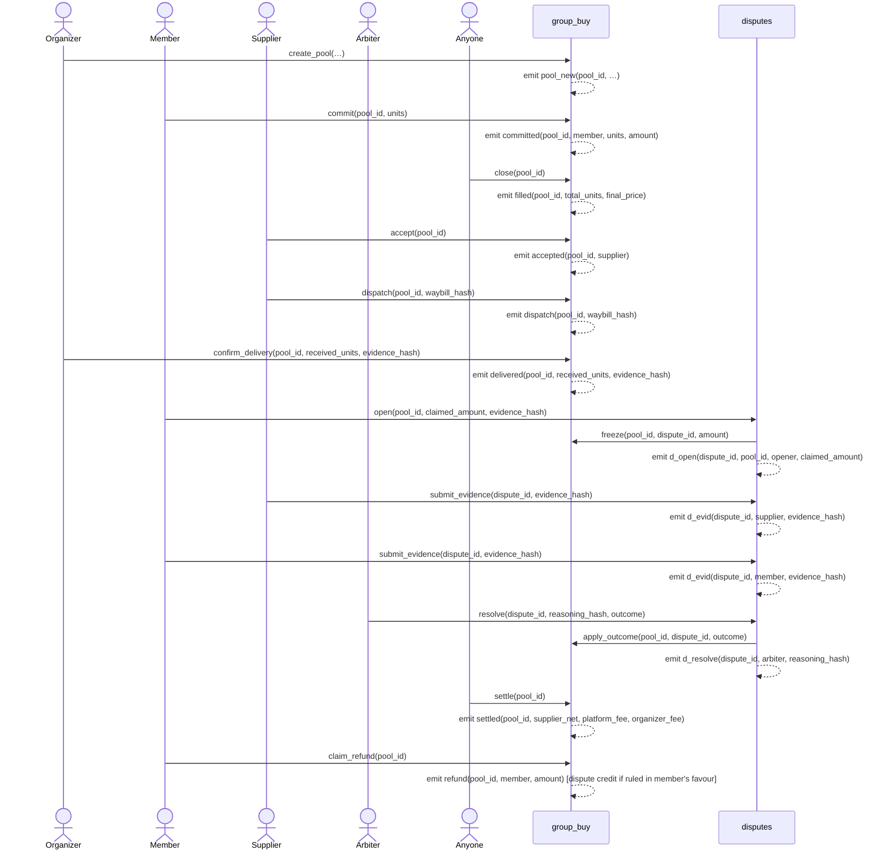
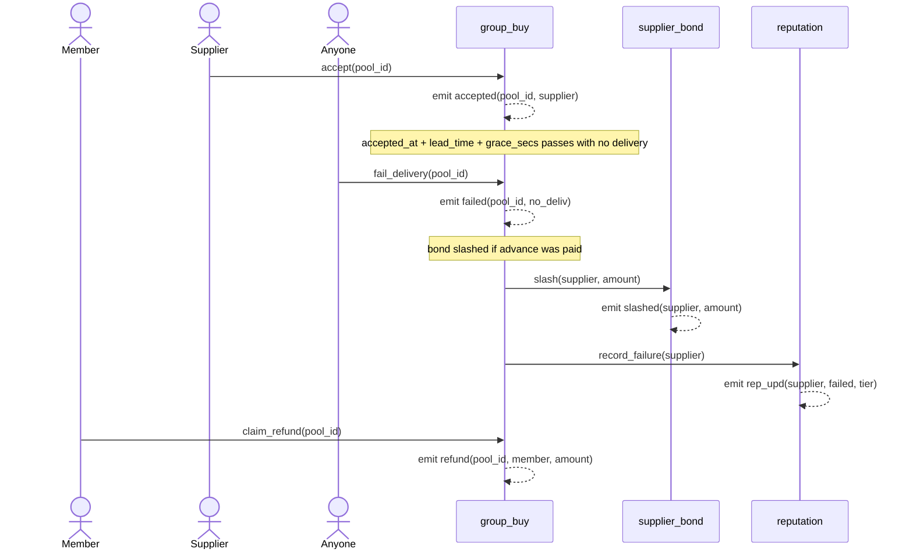

# Pool flows — sequence diagrams

Five main flows through the `group_buy` contract, with every contract call and its emitted event.  
Function names match the `bindings/group_buy` crate.  Events follow the symbols in [`docs/events.md`](events.md).

---

## 1. Happy path — pool fills, supplier delivers, members settle

The common case: organizer opens a pool, traders commit, the pool fills at or above MOQ, the supplier accepts and dispatches, the organizer confirms delivery, and everyone settles.



---

## 2. Expiry path — deadline passes before MOQ is reached

The pool never reaches minimum order quantity; everyone gets a full refund.



---

## 3. Shortfall path — supplier delivers fewer units than ordered

Supplier delivers, but `received_units < total_units`.  Shortfall must be allocated before settlement; undelivered-unit holders receive a pro-rata refund.

```mermaid
sequenceDiagram
    actor Organizer
    actor Member
    actor Supplier
    actor Anyone
    participant GB as group_buy

    Organizer->>GB: create_pool(…)
    GB-->>GB: emit pool_new(pool_id, organizer, supplier, offer_hash, hub_hash)

    Member->>GB: commit(pool_id, units)
    GB-->>GB: emit committed(pool_id, member, units, amount)

    Anyone->>GB: close(pool_id)
    GB-->>GB: emit filled(pool_id, total_units, final_price)

    Supplier->>GB: accept(pool_id)
    GB-->>GB: emit accepted(pool_id, supplier)

    Supplier->>GB: dispatch(pool_id, waybill_hash)
    GB-->>GB: emit dispatch(pool_id, waybill_hash)

    Organizer->>GB: confirm_delivery(pool_id, received_units, evidence_hash)
    Note over GB: received_units < total_units → shortfall recorded
    GB-->>GB: emit delivered(pool_id, received_units, evidence_hash)
    GB-->>GB: emit shortfall(pool_id, missing_units)

    Anyone->>GB: allocate_shortfall(pool_id)
    Note over GB: paged; repeat until alloc_ok
    GB-->>GB: emit alloc_ok(pool_id, received_units)

    Anyone->>GB: settle(pool_id)
    GB-->>GB: emit settled(pool_id, supplier_net, platform_fee, organizer_fee)

    Member->>GB: claim_refund(pool_id)
    GB-->>GB: emit refund(pool_id, member, amount)  [shortfall refund for undelivered units]

    Member->>GB: confirm_pickup(pool_id)
    GB-->>GB: emit pickup(pool_id, member)
```

---

## 4. Dispute path — member opens a dispute after delivery

A member disputes a delivery (wrong goods, damaged goods, etc.).  The dispute contract freezes the affected funds, evidence is submitted, and an arbiter resolves it.



---

## 5. Supplier failure path — supplier does not accept or does not deliver

Two sub-cases: supplier rejects the filled pool, or supplier accepts but never dispatches / delivers within the window.

### 5a. Supplier rejects

```mermaid
sequenceDiagram
    actor Member
    actor Supplier
    actor Anyone
    participant GB as group_buy
    participant Rep as reputation

    Anyone->>GB: close(pool_id)
    GB-->>GB: emit filled(pool_id, total_units, final_price)

    Supplier->>GB: reject(pool_id)
    GB-->>GB: emit rejected(pool_id, supplier)
    Note over GB: pool → Failed; reputation penalty recorded
    GB->>Rep: record_failure(supplier)
    Rep-->>Rep: emit rep_upd(supplier, failed, tier)

    Member->>GB: claim_refund(pool_id)
    GB-->>GB: emit refund(pool_id, member, amount)
```

### 5b. Supplier fails to accept within the accept window

```mermaid
sequenceDiagram
    actor Member
    actor Anyone
    participant GB as group_buy
    participant Rep as reputation

    Anyone->>GB: close(pool_id)
    GB-->>GB: emit filled(pool_id, total_units, final_price)

    Note over GB: accept window expires

    Anyone->>GB: fail_accept(pool_id)
    GB-->>GB: emit failed(pool_id, no_accept)
    Note over GB: pool → Failed; reputation penalty recorded
    GB->>Rep: record_failure(supplier)
    Rep-->>Rep: emit rep_upd(supplier, failed, tier)

    Member->>GB: claim_refund(pool_id)
    GB-->>GB: emit refund(pool_id, member, amount)
```

### 5c. Supplier accepts but fails to deliver


